# Ultrafine Sales Orders

A role-based web application for raising, approving and tracking **sales orders** for an ultrafine materials business (slag powder, fly ash, micro silica). Sales people create orders from customer purchase orders, the accounts in-charge approves or sends them back, and **approved orders are queued for Tally** through a transactional outbox with retries.

Built with FastAPI, SQLAlchemy and MySQL, server-rendered with Jinja2.

> **About the screenshots:** they come from a throwaway demo database filled with fictional customers, GSTINs, rates and people by [`scripts/seed_demo_database.py`](scripts/seed_demo_database.py). No production data is in this repository.

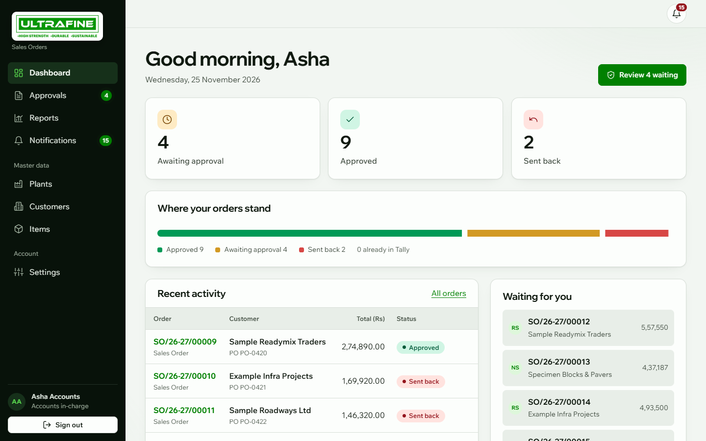

## What it does

- **Three roles:** Sales (own orders only), Accounts in-charge (approves, manages masters) and Admin (users, settings, audit log, Tally queue). Authorisation is enforced on the server for every route.
- **Order workflow:** `Draft -> Awaiting approval -> Approved`, or `Sent back -> edit -> Awaiting approval`. An approver cannot approve their own order.
- **Gap-free numbering per financial year** (for example `SO/26-27/00012`), allocated on first submit, with a separate series for trading orders.
- **GST rule from the company SOP:** the plant's state is compared with the customer's billing state. Same state gives Output CGST + SGST (half rate each), otherwise Output IGST at the full rate. A live tax preview updates as the form is filled in, and the server recalculates on save.
- **Tally queue:** approving an order writes the order and a `tally_outbox` row in **one transaction**, so nothing is lost if Tally is down. A background worker delivers rows with exponential back-off, then marks them for an admin to retry. The real Tally API call is not connected yet; until `TALLY_API_URL` is set, approved orders wait safely in the queue.
- **Notifications:** an in-app bell and inbox, plus email through a database-backed queue with retries (approvers when an order is submitted, creators when it is approved or sent back, admins when delivery fails).
- **Audit and reports:** an append-only audit log of logins and every change, per-order lifecycle timeline, filterable lists with column choice and download, and a reports area.
- **Master data:** customers, items, sales ledgers and plants; sales people only see the plants an admin assigned to them.

## Screens

| | |
|---|---|
| 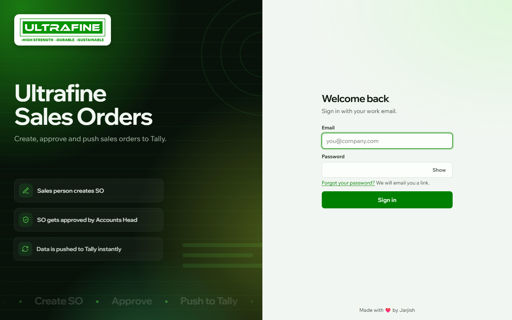 **Sign in** | 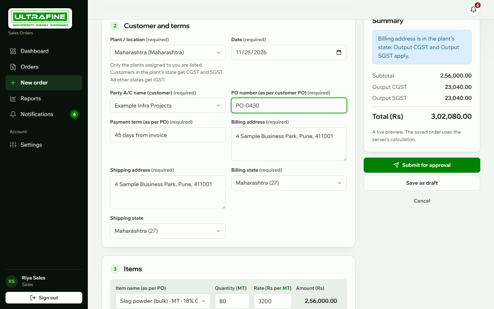 **New order** with live GST preview |
| 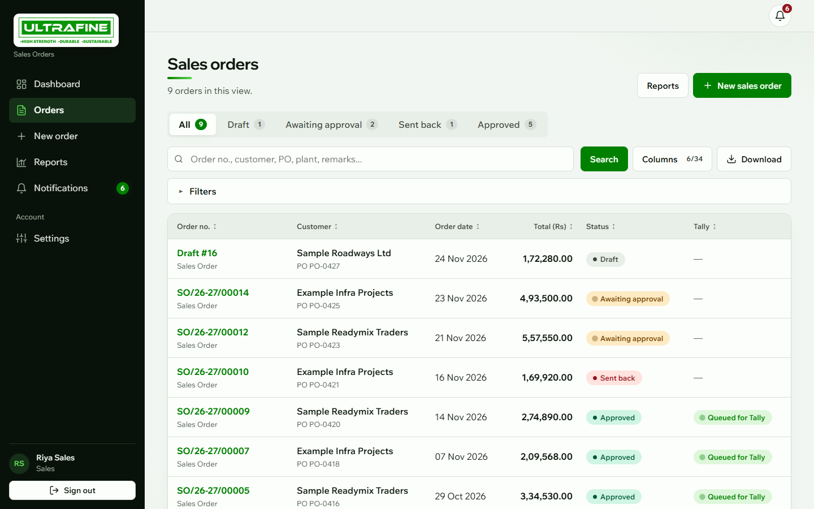 **Sales person's own orders** | 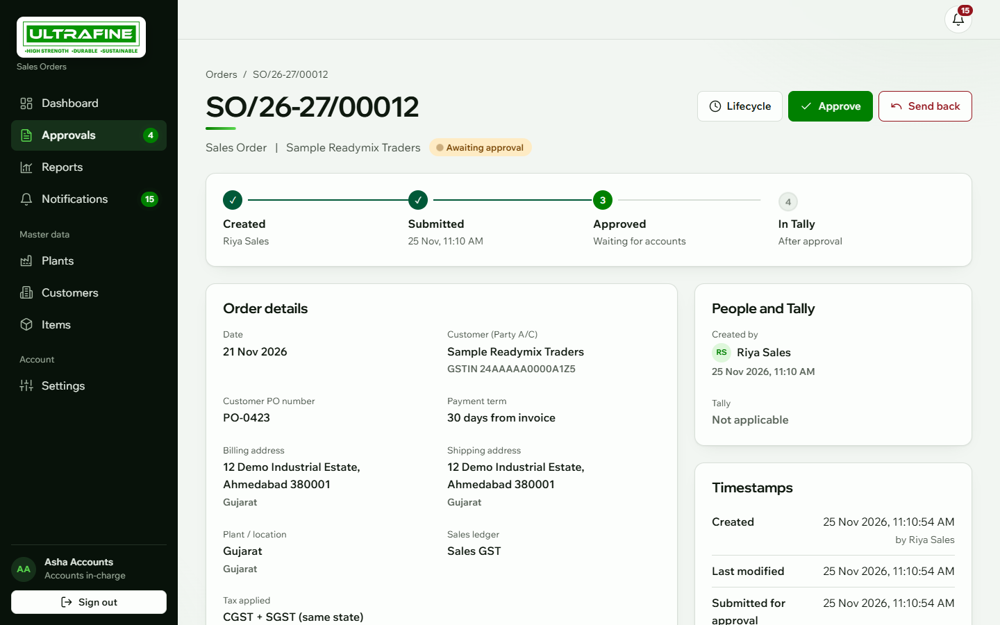 **Approval review**: approve or send back |
| 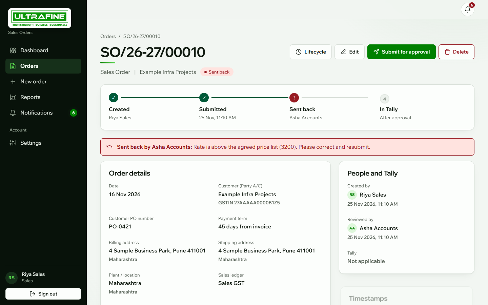 **Sent back** with the approver's reason | 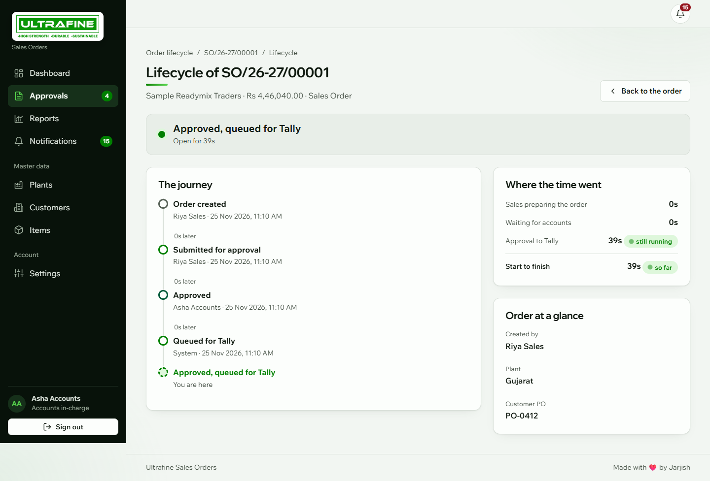 **Order lifecycle** timeline |
| 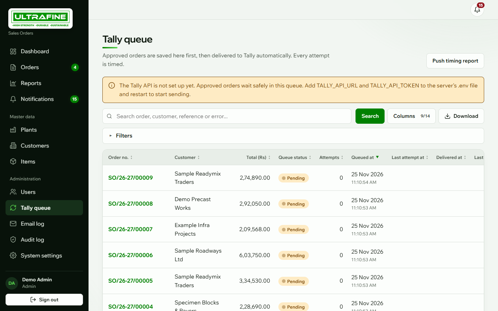 **Tally queue** (admin) | 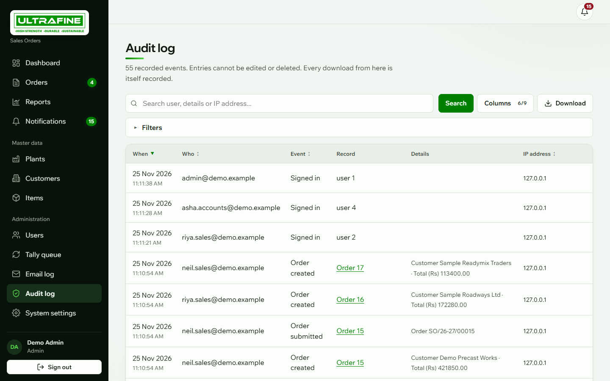 **Audit log** (admin) |
| 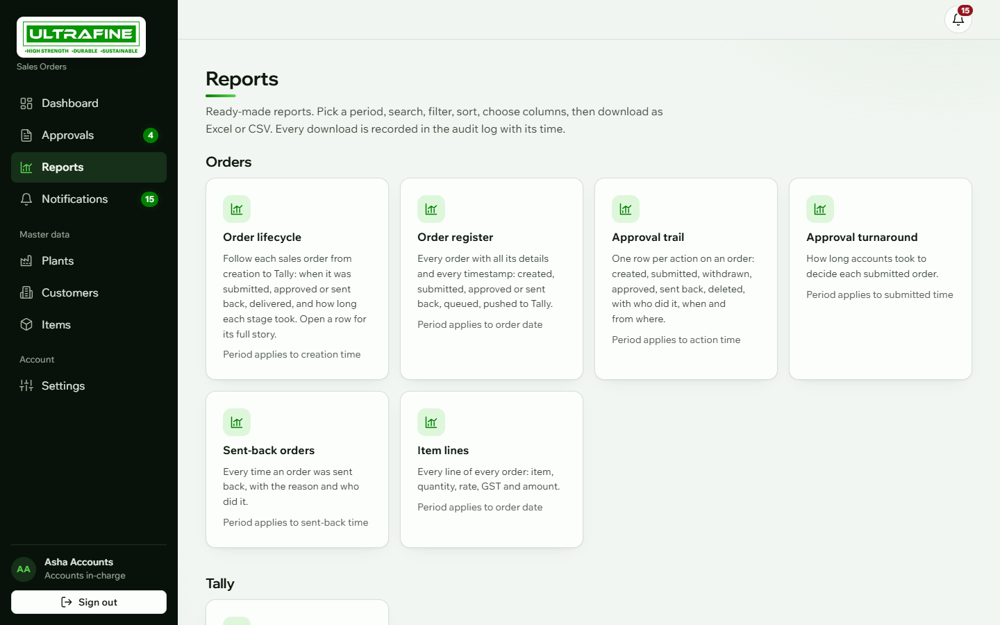 **Reports** | 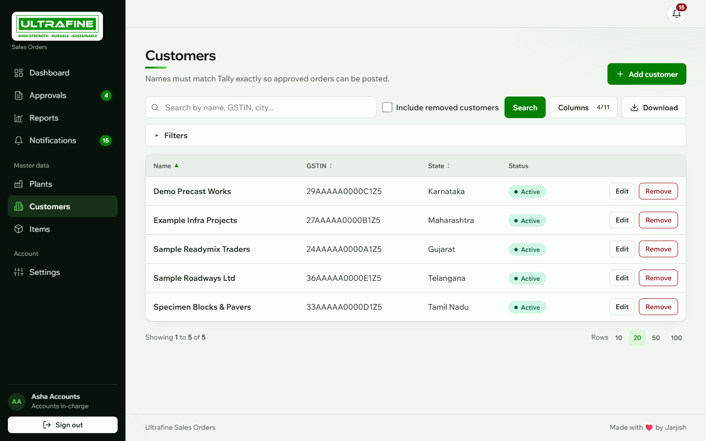 **Customers** master data |
| 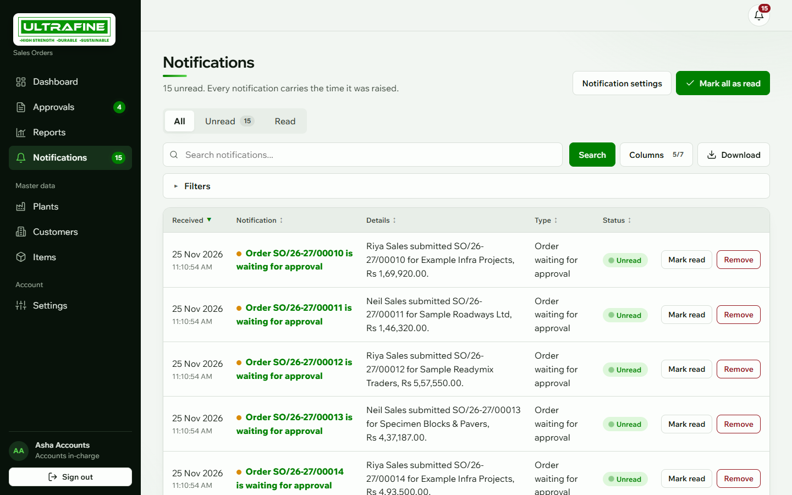 **Notifications** inbox | 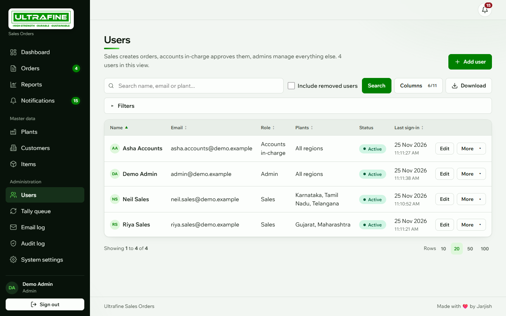 **User management** (admin) |

The layout also works on a phone:

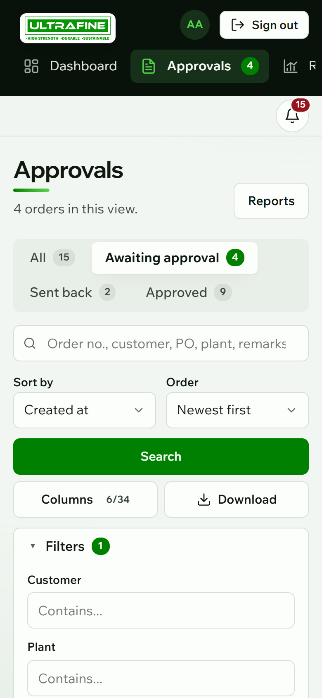

## Architecture

```
Browser (Jinja2 pages, small amount of JS)
   |
FastAPI app  --  routers (auth, orders, masters, reports, notifications, admin)
   |                 services (orders, tax, audit, notify, outbox, emailing, reports)
   |
SQLAlchemy 2 models  --  Alembic migrations  --  MySQL
   |
Background workers in the app process:
   - Tally outbox worker  (claims rows with SKIP LOCKED, back-off, idempotency key)
   - Mail worker          (sends queued emails, retries)
   - Housekeeping         (expired sessions, reminders)
```

```
app/
  core/          settings, database, security, middleware
  models/        SQLAlchemy entities and enums
  routers/       HTTP routes per area
  services/      business logic (orders, tax, audit, outbox, notifications, reports)
  integrations/  Tally gateway (the only file to change once the Tally API is known)
  templates/     Jinja2 pages
alembic/         database migrations
scripts/         demo data and screenshot helpers
tests/           pytest suite (runs against a separate test database)
docs/            user and operations guide, screenshots
```

**Stack:** Python, FastAPI, Uvicorn, SQLAlchemy 2, Alembic, PyMySQL, Jinja2, Pydantic settings, argon2-cffi, openpyxl, pytest.

## Quick start

You need Python 3 and a MySQL server.

```powershell
python -m venv venv
.\venv\Scripts\pip install -r requirements-dev.txt
copy .env.example .env          # then fill in SECRET_KEY, database settings, ADMIN_EMAIL / ADMIN_PASSWORD
.\venv\Scripts\python.exe -m alembic upgrade head
.\venv\Scripts\python.exe -m app.cli seed-admin
.\venv\Scripts\python.exe -m app.cli serve              # http://127.0.0.1:1401
```

### Try it with demo data

Use a separate database whose name ends in `_demo` (the seed script refuses to run on anything else):

```powershell
# in .env: DB_NAME=tally_so_demo
.\venv\Scripts\python.exe -m alembic upgrade head
.\venv\Scripts\python.exe -m app.cli seed-admin
.\venv\Scripts\python.exe scripts/seed_demo_database.py masters
.\venv\Scripts\python.exe -m app.cli serve              # keep this running, then in another terminal:
.\venv\Scripts\python.exe scripts/seed_demo_database.py orders http://127.0.0.1:1401
```

Demo users (all with the password printed by the script): `riya.sales@demo.example`, `neil.sales@demo.example`, `asha.accounts@demo.example`, plus the admin from `.env`.

### Tests

```powershell
$env:MAIL_ENABLED="true"; $env:MAIL_FROM="no-reply@rdc.in"; $env:APP_BASE_URL="http://localhost:1401"
.\venv\Scripts\python.exe -m pytest
```

The suite (114 tests covering the order workflow, lists and reports, notifications and email, and unit logic) uses its own `TEST_DB_NAME` database and refuses to run against the real one. The three environment variables above are what the email tests expect; without them two of those tests fail. Run one pytest process at a time, because each run rebuilds the test schema.

## Security

Argon2id password hashing with lockout and throttling, server-side sessions stored as SHA-256 hashes, CSRF tokens on every state-changing request, strict Content Security Policy, soft deletes and an append-only audit log. The full list, and how to report a problem, is in [SECURITY.md](SECURITY.md) and the [guide](docs/USER_GUIDE.md#security-measures).

## Documentation

- [User and operations guide](docs/USER_GUIDE.md): roles, running it, notifications and email, the Tally queue, security measures, going live.
- [SECURITY.md](SECURITY.md) and [CONTRIBUTING.md](CONTRIBUTING.md).
